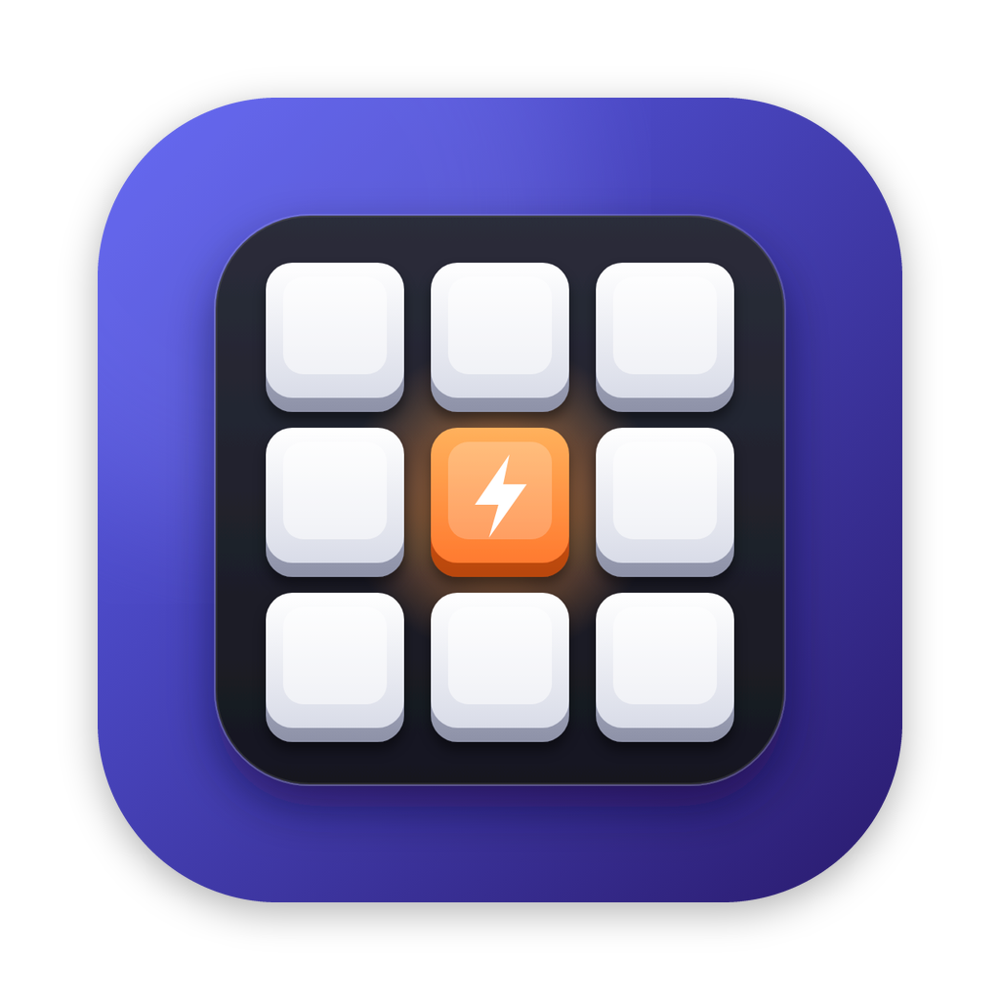

<p align="center"></p>

# bnk8

Open-source tools for the **Binepad BNK8 AI Edition** macropad (8 keys + a push knob): a command-line tool, a desktop configurator, and documentation of the device's USB protocol.

It programs key bindings, knob gestures, macros, lighting and timing directly over USB. You don't need Binepad's own software.

> Not affiliated with or endorsed by Binepad. Tested on macOS with firmware 6.0.0 (reported internally as 6.0.25). Windows and Linux builds should work but are untested.

## What's in here

| Part | Path | What it does |
|---|---|---|
| `bnk8` CLI | `src/` | List devices, dump the config as TOML, apply a TOML config, change single bindings, factory reset, MCP server for Claude |
| `bnk8-gui` | `gui/` | Desktop configurator: keypad editor, macros, timing, lighting, layer templates |
| Protocol notes | [`PROTOCOL.md`](PROTOCOL.md) | Reverse-engineered frame format, commands and 2000-byte config layout |

## Download (macOS)

Get the latest build from [Releases](https://github.com/alexdibattista/bnk8-ai/releases). Builds run on Apple Silicon and Intel Macs with macOS 11 or newer.

- **App:** open `BNK8-Configurator-<version>-macos-universal.dmg` and drag **BNK8 Configurator** to Applications.
- **CLI:** extract `bnk8-<version>-macos-universal.tar.gz` and move `bnk8` somewhere on your `PATH`, e.g. `/usr/local/bin`.

Releases marked **unsigned** are pre-releases whose file names end in `-unsigned`, e.g. `BNK8-Configurator-<version>-macos-universal-unsigned.dmg`. They aren't notarized by Apple, so macOS blocks them the first time you open them. After the "could not verify" warning, go to **System Settings → Privacy & Security** and click **Open Anyway**. Or clear the download flag in Terminal:

```sh
xattr -dr com.apple.quarantine "/Applications/BNK8 Configurator.app"
xattr -d com.apple.quarantine bnk8
```

Maintainers: see [RELEASING.md](RELEASING.md).

## Build

Requires Rust 1.92 or newer (the GUI's file-dialog dependency, `rfd`, sets that minimum).

```sh
cargo build --release                 # CLI  -> target/release/bnk8
cargo build --release -p bnk8-gui     # GUI  -> target/release/bnk8-gui
```

Or install both onto your `PATH`:

```sh
cargo install --path .
cargo install --path gui
```

On Linux, `hidapi` needs the udev development headers (`libudev-dev` on Debian/Ubuntu), and your user needs access to the device's hidraw node, usually through a udev rule for vendor `4249`, product `4e41`.

## Desktop app

```sh
cargo run --release -p bnk8-gui
```

Plug the BNK8 in first; the app finds and loads it on startup (press **Refresh** if you plug it in later).

- **Keys & lighting**: click a key or the knob on the keypad, then choose what each gesture does (tap, double tap, hold, tap then hold; the knob also has turn left/right). Set the layer's effect, brightness, speed and colour, a colour per key, and whether every layer shares one lighting setup.
- **Macros**: up to 15 macros of up to 7 key steps, with optional delays.
- **Timing**: double-tap window and hold threshold.
- **Layer templates**: **+ Add from template…** adds a ready-made layer for **Zoom** or **Google Meet** (macOS or Windows/Linux shortcuts). Shortcuts with modifier keys are stored as macros, so each template uses up to 6 free macro slots.
- Edits stay local until you press **Apply to device**. The bottom bar shows how many changes are pending, and you can list them. **Import/Export TOML** uses the same format as the CLI.

## Command line

```sh
bnk8 list                         # attached devices
bnk8 info                         # firmware, capacity, config state
bnk8 dump -o my-config.toml       # current config as TOML
bnk8 apply my-config.toml --dry-run   # show per-item changes only
bnk8 apply my-config.toml         # validate, show changes, write
bnk8 reset                        # restore the factory config
```

Change one setting without a file:

```sh
bnk8 set key 1 keyboard.arrow_up               # K1 tap = up arrow
bnk8 set key 7 keyboard.f9 --slot hold         # K7 hold = F9
bnk8 set knob cw media.volume_up --layer 2     # knob turn right on layer 2
bnk8 set lighting --layer 0 --effect solid --color "#730000" --brightness 80
```

Keys are numbered 1 to 8 from top left to bottom right, skipping the knob (top right). With several devices attached, add `--serial <SERIAL>` (see `bnk8 list`).

## Use with Claude

`bnk8 mcp` runs a [Model Context Protocol](https://modelcontextprotocol.io) server on stdin/stdout. Add it to Claude Desktop or Claude Code, which run on your own Claude subscription, and ask Claude to build macros, bindings, knob gestures or lighting for you.

Claude gets four tools:

- `get_config`: reads the current config as TOML.
- `list_actions`: lists the action names a binding or macro step can use.
- `preview_config`: validates an edited config and lists the per-item changes, without writing. It returns a preview id.
- `apply_config`: writes the config. It needs the preview id for that exact config and an unchanged device, so you always see the changes before anything is written.

Your client asks you to approve each tool call. The keypad is opened only for the duration of a call, so Binepad Studio, the desktop app and the CLI can keep using it.

**Claude Desktop:** add this to `~/Library/Application Support/Claude/claude_desktop_config.json`, then restart Desktop:

```json
{"mcpServers": {"bnk8": {"command": "/usr/local/bin/bnk8", "args": ["mcp"]}}}
```

**Claude Code:**

```sh
claude mcp add bnk8 -- /usr/local/bin/bnk8 mcp
```

Use the path where you installed `bnk8`. To pick one of several keypads, add `--serial <SERIAL>` before `mcp`.

## Config format

```toml
format = 2
device = "binepad.bnk8"

[timing]
double_tap_ms = 260
hold_ms = 350

[[layers]]                     # up to 10 layers
name = "Media"                 # optional; kept on keypads Binepad Studio has saved to
keys = [
    "keyboard.arrow_up",       # K1 tap only
    "keyboard.arrow_down",     # K2
    "macro.1",                 # K3 plays macro 1
    "media.play_pause",        # K4
    "none",                    # K5 unbound
    "keyboard.escape",         # K6
    { hold = "keyboard.f9" },  # K7: several gestures as a table
    { tap = "media.mute", double_tap = "media.next" },  # K8
]

[layers.knob]                  # tap, double_tap, hold, tap_hold, ccw, cw
tap = "layer.next"
ccw = "media.volume_down"
cw = "media.volume_up"

[layers.lighting]
effect = "solid"               # off, solid, breathing, wave, reactive, … or an id up to 50
brightness = 80                # up to 180
speed = 120
color = "#730000"
key_colors = ["none", "none", "#00FF00", "none", "none", "none", "none", "none"]  # optional, K1..K8
# shared = true                # same lighting on every layer (set it on all layers)

[macros]                       # up to 15 macros (1..15), up to 7 key steps each
1 = ["press modifier.left_control", "delay 10", "tap keyboard.q", "delay 10", "release modifier.left_control"]
```

[`configs/omp.toml`](configs/omp.toml) is a complete real-world config.

**Action names** are Binepad Studio's, so configs show the same names Studio does.

| Group | Examples |
|---|---|
| Keyboard | `keyboard.a`, `keyboard.f13`, `keyboard.arrow_up`, `keyboard.numpad.7`, `keyboard.page_up` |
| Modifiers | `modifier.left_control`, `modifier.left_shift`, `modifier.left_alt`, `modifier.left_gui`, `modifier.right_*` |
| Media | `media.volume_up`, `media.volume_down`, `media.mute`, `media.play_pause`, `media.next`, `media.previous` |
| Layers | `layer.next`, `layer.previous`; go to layer `layer.1` … `layer.10`, hold for layer `layer.mo.1` …, toggle layer `layer.tg.1` … (1 = the first layer) |
| Lighting | `rgb.toggle`, `rgb.brightness.up`, `rgb.effect.next`, `rgb.effect.breathing`, `rgb.restore`, … |
| Macros | `macro.1` … `macro.15` |
| Claude, Codex, desktop | `claude.accept`, `codex.task.new`, `system.edit.copy`, … — Binepad Studio's actions. Studio must be running for them to work (a few desktop actions, such as `system.edit.copy`, also run on the keypad on macOS) |
| Other | `none` (unbound); `raw.<14 hex>` for entries bnk8 can't name, kept byte for byte |

Macro steps are `tap <key>`, `press <key>`, `release <key>` and `delay <ms>` (a multiple of 10, up to 2550 per step). `<key>` is a `keyboard.*`, `modifier.*` or `media.*` name.

Files without `format = 2` use bnk8's earlier names (`keyboard.up`, `keyboard.left_ctrl`, 0-based `layer.0`/`macro.0`). bnk8 still reads them and converts them; `dump` and Export write the new format.

Keyboard bindings send a single key. For a shortcut like Cmd+Shift+A, put it in a macro and bind `macro.N`.

**Gestures.** `tap` fires immediately when a key has no other gestures; otherwise it waits out the double-tap window. `hold` presses when the hold threshold passes and releases with the key, which makes push-to-talk possible.

Keep a `layer.next` binding (factory: knob press) on every layer so you can always switch layers.

## How reading the config works

The device reports a CRC-32 of its active config, and bnk8 trusts a config only when its CRC matches. It looks in three places: the copy saved in the device's profile store (where Binepad Studio, and then bnk8, save), the file bnk8 saves after every write (`~/.local/state/bnk8/<serial>.bin`, or `$XDG_STATE_HOME/bnk8/`), and the built-in factory config (also those of firmware 6.0.19, 6.0.21 and 6.0.24). With the profile store's copy, `dump`, `info` and the app also show the layer names.

If none of them matches (for example, another tool wrote the config), it shows as **unknown**: editing starts from the factory defaults, and applying writes the whole config. Every write replaces all 2000 bytes; the per-item changes shown are for your review.

## Keypads Binepad Studio has saved to

Once Binepad Studio has saved to the keypad, the firmware accepts config writes only through its profile store, and reloads that copy at every power-up. bnk8 then saves there the way Studio does: the config together with Studio's profile, updated to match. Studio and its background agent see bnk8's changes and keep them, and Studio's own settings (layer names, app switching rules, desktop macros) are preserved.

Studio's profile can't hold everything a TOML file can, so on these keypads bnk8 refuses, before writing anything:

- timing other than `double_tap_ms = 260` and `hold_ms = 350` (Studio's profile has no timing settings);
- effects without a name, and lighting `flags` or `extra`;
- actions on a gesture Studio doesn't allow for them (for example `layer.mo.N` only on tap), and `raw.*` actions Studio doesn't know;
- a model/effort selector (`claude.model-effort.knob`, …) that doesn't take the whole knob: tap and both turns.

Layers without a `name` keep the name they have. Keypads Studio has never saved to are written directly, as before, and don't keep layer names.

Details are in [`PROTOCOL.md`](PROTOCOL.md). bnk8 never sends message `0x42` (factory reset or a flash rewrite; unresolved).

## License

Licensed under either of

- Apache License, Version 2.0 ([LICENSE-APACHE](LICENSE-APACHE))
- MIT license ([LICENSE-MIT](LICENSE-MIT))

at your option.

Unless you explicitly state otherwise, any contribution you intentionally submit for inclusion in this work, as defined in the Apache-2.0 license, is dual licensed as above, without any additional terms or conditions.

The bundled Inter fonts (`gui/assets/fonts/`) are under the SIL Open Font License 1.1; see `gui/assets/fonts/Inter-LICENSE.txt`. `assets/factory-config.bin` is the device's factory configuration, included so a factory reset works offline. It is not covered by this project's license.
